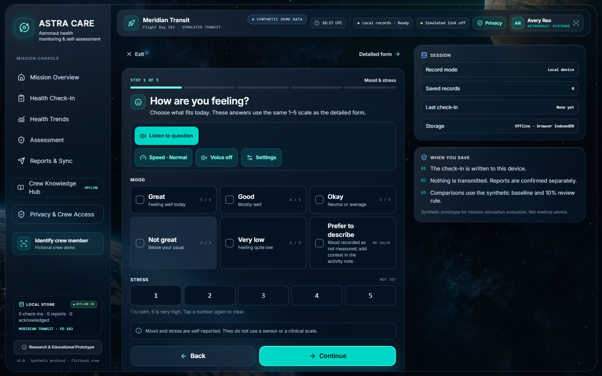
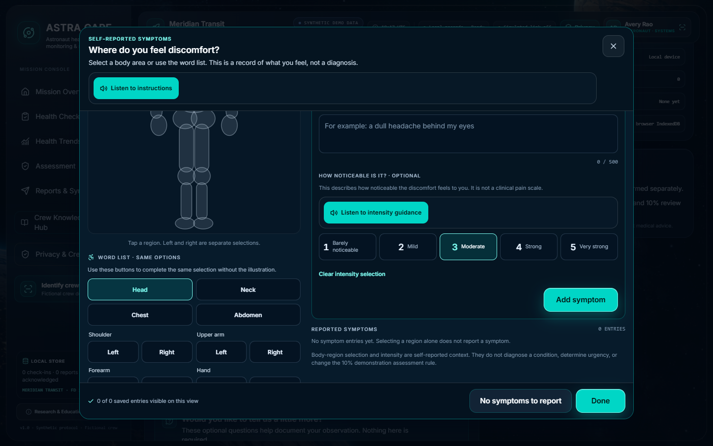
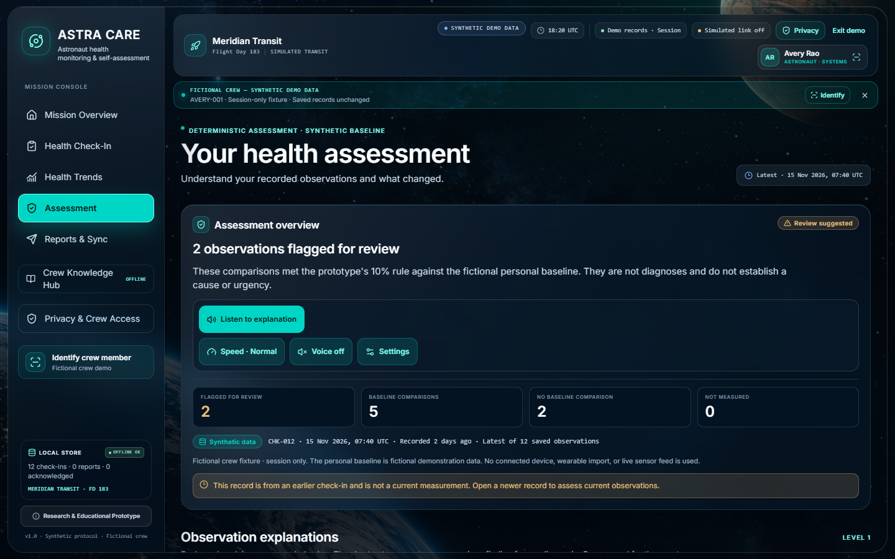
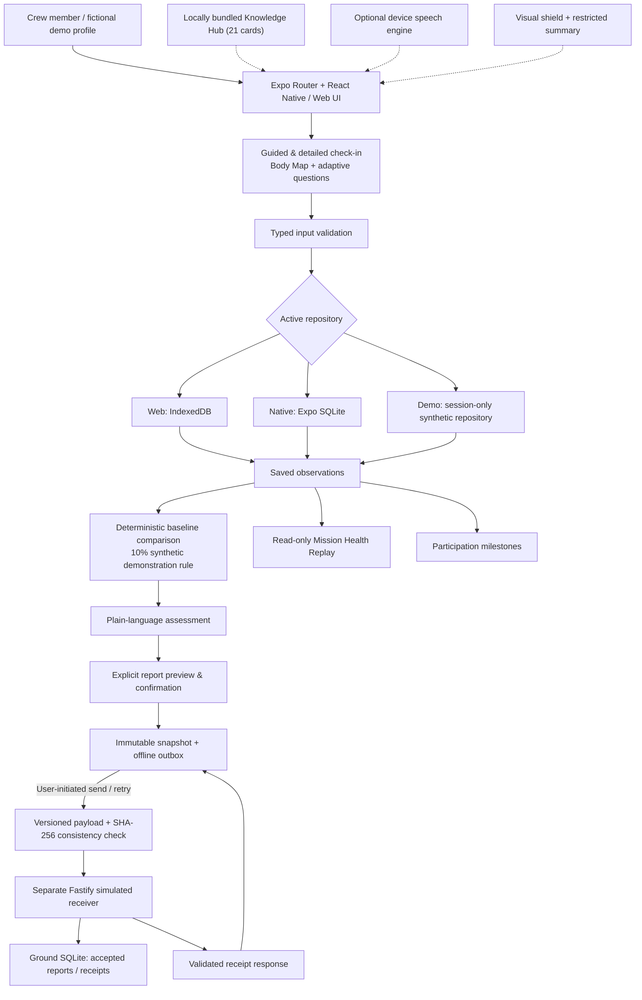

<div align="center">

# 🚀 ASTRA CARE

### Every Observation Matters. Even Beyond Earth.

**An explainable, offline-first astronaut health companion**

*NASA Space Apps Challenge 2026 — independent hackathon prototype*

[](#-validation-evidence)
[](tsconfig.json)
[](package.json)
[](#-team--credits)

[Explore Features](#-what-we-built) · [Architecture](#-system-architecture) · [Quick Start](#-run-locally) · [Demo](#-three-minute-judge-demo) · [Limitations](#-scope--safety)

</div>

---

> **Mission statement:** Make the recording, understanding, and responsible sharing of astronaut health observations simpler — even when connectivity is limited and Earth is far away.

> **Prototype disclosure:** ASTRA CARE is a **synthetic educational prototype**. It is **not** NASA-approved, clinically validated, flight-certified, or intended to replace mission medical procedures. All crew profiles and readings are fictional. The project is not affiliated with or endorsed by NASA.

---

## 🌌 The Problem

Space health monitoring is not only about collecting measurements. A useful crew-facing workflow also needs to help people **document symptoms in context, understand what recorded changes mean, revisit historical trends, and manage the reality of communication delays**. On long-duration missions — to the Moon, Mars, or beyond — astronauts carry much of the responsibility for spotting changes in their own health.

NASA's Human Research Program identifies [five hazards of human spaceflight](https://www.nasa.gov/hrp/hazards/): space radiation, isolation and confinement, distance from Earth, altered gravity, and hostile closed environments. Each hazard can produce cascading health effects that benefit from early observation and clear documentation.

ASTRA CARE explores a **complementary, human-centered software layer** to help astronauts record, understand, and responsibly communicate their observations.

---

## ✨ What We Built

| # | Capability | What It Does |
|---|---|---|
| 01 | **Guided 60-Second Check-In** | Step-by-step health observation entry. Each question is explained, with an optional detailed-form alternative for experienced users. |
| 02 | **Plain-Language Assessment** | Explains recorded values, personal-baseline comparisons, and calculation details in plain language — no jargon. |
| 03 | **Mission Health Replay** | Read-only historical timeline of all saved check-ins, with deterministic point-in-time assessment for each record. |
| 04 | **Mission Wellness Journey** | Optional participation milestones that track consistent check-in habits. Milestones are **participation-based**, never rewards for specific vital-sign values. |
| 05 | **Interactive Body Map** | Front/back SVG symptom selection with an accessible text-list alternative. Symptoms add written context to observations. |
| 06 | **Offline Crew Knowledge Hub** | 21 locally bundled educational cards covering the five spaceflight hazards, with research references and full-text search. No network required. |
| 07 | **Voice Guidance** | Optional text-to-speech reads check-in questions and knowledge explanations. Requires installed device speech engine; all primary interactions have visible text. |
| 08 | **Adaptive Follow-Up Questions** | Deterministic context questions triggered by selected symptoms. These are structured prompts for richer documentation — **not clinical triage**. |
| 09 | **Crew Privacy Dashboard** | Restricted operational summary and visual privacy shield. The shield conceals on-screen information; it is **not** device authentication or encryption. |

**Also included:** fictional crew demo-profile selection (not real QR scanning or NFC authentication), local-first records, immutable confirmed-report snapshots, an offline outbox, explicit send/retry, and a separate simulated ground receiver with SQLite-persisted receipts.

---

## 🧭 The Crew Journey

```
Identify demo crew
  → Guided or detailed check-in
  → Body Map / adaptive context questions
  → Validate & save locally
  → Understand plain-language assessment
  → Explore replay & knowledge hub
  → Confirm report (creates immutable snapshot)
  → Report queued in offline outbox
  → Explicit user-initiated send
  → Validate simulated ground receipt
```

A **disconnected application** can still record observations, run assessments, browse the knowledge hub, and queue reports. Restored connectivity alone **never** marks a report as delivered — only an explicit send action and validated receiver receipt can do that.

---

## 📸 Screenshots

> Real application captures — taken from the live web build.

| Mission Overview | Guided Check-In | Interactive Body Map |
|---|---|---|
|  |  |  |

| Plain-Language Assessment | Mission Health Replay | Reports & Sync |
|---|---|---|
|  |  |  |

> **Note:** If the images above do not render, screenshots have not yet been added to `docs/assets/screenshots/`. See the [Judge Demo Runbook](docs/JUDGE_DEMO_RUNBOOK.md) for a step-by-step walkthrough of each screen.

---

## 🏗 System Architecture



**Data flow summary:** Observations enter via guided or detailed check-in and are validated before local storage. The assessment engine applies a deterministic 10%-deviation rule against the fictional synthetic baseline. Reports are confirmed as immutable snapshots and queued locally; the user explicitly initiates each send attempt. The simulated receiver stores accepted payloads in SQLite and returns a validated receipt. Knowledge, replay, milestones, and voice all work without network access.

**Trust boundaries:** Demo profile selection is not authentication. Local storage is not production-encrypted. SHA-256 checks are for payload consistency, not secure communications. Web offline capability requires a previously installed, retained cache.

---

## 🛠 Tech Stack

| Layer | Technologies |
|---|---|
| **App framework** | React Native 0.88, Expo SDK 58, TypeScript (strict) |
| **Routing** | Expo Router 58 (file-based, typed routes) |
| **UI** | React Native Web, Expo Linear Gradient, Expo Blur, Lucide icons, react-native-svg |
| **State** | React Context + useReducer, isolated PresentationSession |
| **Web persistence** | IndexedDB (via web repository adapter) |
| **Native persistence** | Expo SQLite (via native repository adapter) |
| **Assessment** | Deterministic rule-based comparisons, plain-language explanation templates |
| **Speech** | expo-speech with visible text fallback |
| **Simulated receiver** | Fastify 5, Node.js, node:sqlite (experimental) |
| **Testing** | Node.js built-in test runner (217 unit + receiver tests), browser journey scripts |
| **Quality** | TypeScript strict, Expo lint (ESLint), Prettier |

---

## ⚡ Run Locally

**Prerequisites:** Node.js 22.19 or later (Node 22 series). `npm ci` installs exact locked versions. Use synthetic data only.

### Development web server

```bash
git clone https://github.com/OMKAR-PSN/ASTRA.git
cd ASTRA
npm ci
npm run web
```

The development server prints the local URL. Open it in your browser.

### Production web build (offline demo)

```bash
npm run build:web   # exports to dist/web + generates service-worker cache
npm run preview:web # serves dist/web locally
```

Open the served site **online at least once**, allow the service worker to install, then test cached pages offline. A first-ever visit without network is not supported by the cache.

### Optional simulated ground receiver

In a separate terminal:

```bash
npm run receiver
```

Configure the receiver URL **before** building the web app. In PowerShell:

```powershell
$env:EXPO_PUBLIC_RECEIVER_URL = "http://127.0.0.1:8787"
npm run build:web
npm run preview:web
```

The ground timeline is then visible at `http://127.0.0.1:8787/mission`.

> **Phone testing:** On a phone, `localhost` refers to the phone itself, not your PC. Use your PC's LAN IP address instead. See [docs/EXPO_GO_SETUP.md](docs/EXPO_GO_SETUP.md) for the full Expo Go setup guide.

---

## 🔑 Environment Variables

Create a `.env.local` file (gitignored) based on the provided template:

```bash
cp .env.example .env.local
```

| Variable | Purpose | Default |
|---|---|---|
| `EXPO_PUBLIC_RECEIVER_URL` | URL of the simulated ground receiver | *(unset — delivery disabled)* |

**Without a receiver URL**, the app works fully for local check-ins, assessments, replay, and report queuing. Only the final send step requires a reachable receiver.

---

## 🧪 Validation Evidence

The **17 November 2026 integration audit** (`0897e31`) reported:

| Check | Result |
|---|---|
| Unit and receiver tests | **217 / 217 passed** |
| Feature/navigation browser assertions | **453 / 453 passed** |
| Combined browser journey | **39 checks passed** |
| TypeScript strict check | ✅ Passed |
| Expo lint | ✅ Passed |
| Production web export | ✅ Passed |
| Android / iOS JS & asset exports | ✅ Passed — **not** on-device validation |

Reproduce the core gates locally:

```bash
npm test          # 217 unit + receiver tests
npm run typecheck # TypeScript strict check
npm run lint      # Expo lint
npm run build:web # production web export
```

Full evidence and defect history: [`docs/FINAL_INTEGRATION_AUDIT.md`](docs/FINAL_INTEGRATION_AUDIT.md)

> These counts are historical verification results, **not** clinical, security, accessibility, or native-device certification.

---

## 🎬 Three-Minute Judge Demo

1. **Identify:** Choose the fictional **Avery Rao** demo crew profile (clearly marked as synthetic).
2. **Record:** Open **Guided Check-In**, answer the step-by-step questions, add a Body Map symptom.
3. **Explain:** Inspect the **Plain-Language Assessment** — expand the calculation detail section.
4. **Explore:** Open **Mission Health Replay** and navigate a historical review event.
5. **Protect:** Show the restricted crew summary and activate the **Visual Privacy Shield**.

### Extended path (optional)

6. Browse the offline **Knowledge Hub** — search for "radiation" with no network.
7. Confirm the latest check-in as a report, queue it, explicitly send it, and verify the **simulated ground receipt**.

> See [`docs/JUDGE_DEMO_RUNBOOK.md`](docs/JUDGE_DEMO_RUNBOOK.md) for the full step-by-step script. Voice playback is optional — do not depend on audible output unless tested on the presentation device.

---

## 🔐 Scope & Safety

| Boundary | What ASTRA CARE Does | What It Does Not Do |
|---|---|---|
| **Sensing** | Manual observation entry, fictional demo fixtures | Live wearable, NFC, or real sensor integration |
| **Assessment** | 10% synthetic demonstration comparison | Medical diagnosis or validated clinical thresholds |
| **Identity** | Fictional demo profile selection | Real authentication, per-user data ownership |
| **Security** | Local storage, visual privacy shield | Production encryption, authenticated access control |
| **Ground link** | Simulated Fastify receiver with SQLite receipts | Real ground-control or satellite communication |
| **Speech** | Optional expo-speech with text fallback | Guaranteed offline voice across all device types |
| **Native** | JavaScript and asset export confirmed | On-device runtime, TalkBack/VoiceOver verification |
| **Offline web** | Service-worker cache after first online visit | First-ever visit without network |

These boundaries are deliberate and documented. ASTRA CARE is an **engineering and usability proof of concept**.

---

## 🔭 Future Roadmap

- Expert review of observation workflows with flight medicine and human factors specialists
- Real-device testing (Android, iOS) and accessibility audits (TalkBack, VoiceOver)
- Secure local identity design (not demo card selection)
- Authorized sensor and wearable integration research
- Clinical validation of any health thresholds before deployment
- Mission-system communication integration research
- Production data protection and encryption

---

## 📚 Research Context

- [NASA Human Research Program — Hazards of Human Spaceflight](https://www.nasa.gov/hrp/hazards/)
- [NASA HRP — Risks of Human Spaceflight](https://www.nasa.gov/hrp/risks/)
- [Canadian Space Agency — Bio-Monitor](https://www.csa-asc.gc.ca/eng/sciences/bio-monitor.asp)
- [NASA — Cardiovascular Health in Microgravity](https://www.nasa.gov/missions/station/cardiovascular-health-in-microgravity/)

These sources provide **general problem context**, not validation or endorsement of ASTRA CARE.

---

## 👩‍🚀 Team & Credits

**Hackathon:** NASA Space Apps Challenge 2026

| Role | Member |
|---|---|
| Team name | *[Add your team name]* |
| Member 1 | *[Name — responsibility]* |
| Member 2 | *[Name — responsibility]* |
| Member 3 | *[Name — responsibility]* |

> **Before publishing:** replace all placeholders above with verified names and confirm the applicable project license. Do not imply an open-source license unless a LICENSE file is actually included in this repository.

---

## 📂 Documentation Index

| Document | Purpose |
|---|---|
| [docs/JUDGE_DEMO_RUNBOOK.md](docs/JUDGE_DEMO_RUNBOOK.md) | Step-by-step judge demonstration script |
| [docs/FINAL_JUDGE_QA.md](docs/FINAL_JUDGE_QA.md) | Defensible answers to common judge questions |
| [docs/FINAL_INTEGRATION_AUDIT.md](docs/FINAL_INTEGRATION_AUDIT.md) | Full integration audit with test evidence |
| [docs/KNOWN_LIMITATIONS.md](docs/KNOWN_LIMITATIONS.md) | Known limitations and release gates |
| [docs/EXPO_GO_SETUP.md](docs/EXPO_GO_SETUP.md) | Expo Go phone setup guide |
| [docs/decisions.md](docs/decisions.md) | Key implementation decisions log |
| [docs/PROGRESS.md](docs/PROGRESS.md) | Feature milestone history |

Feature implementation notes are in `docs/` — one per feature milestone.

---

<div align="center">

### ✨ Every Observation Matters. Even Beyond Earth.

*ASTRA CARE — NASA Space Apps Challenge 2026 — Independent hackathon prototype*

</div>
