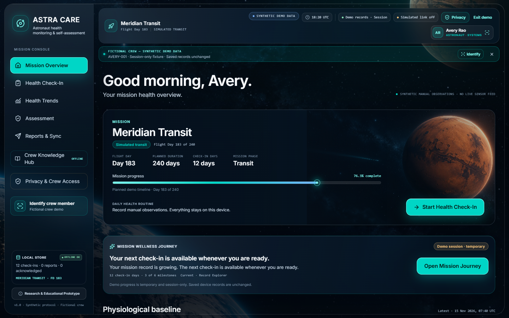
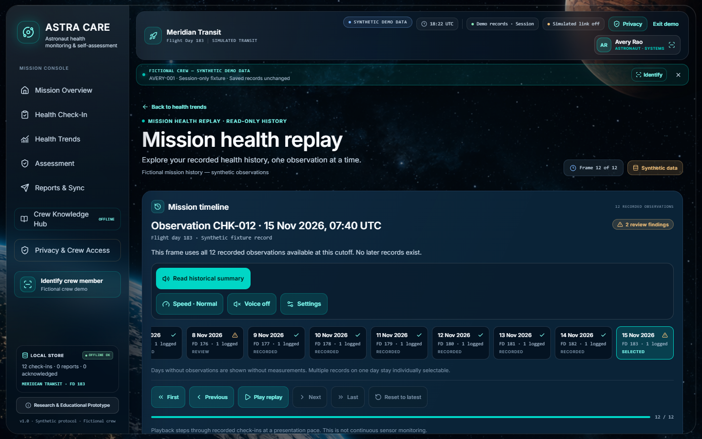
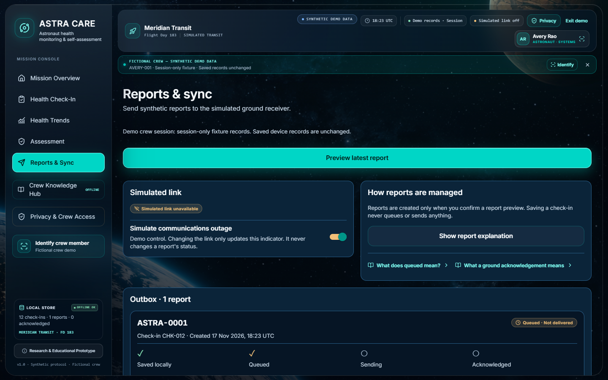
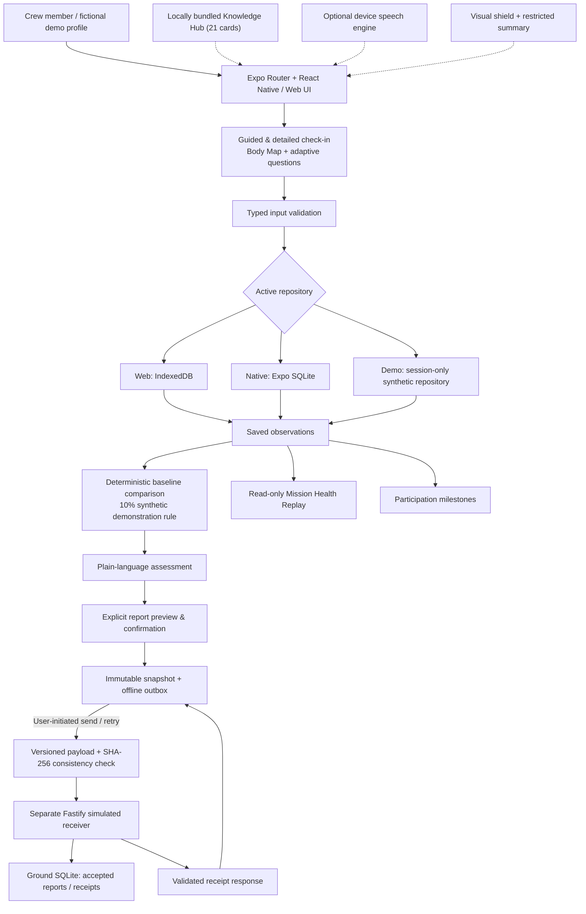

<div align="center">

# 🚀 ASTRA CARE

### Every Observation Matters. Even Beyond Earth.

**An explainable, offline-first astronaut health companion**

*NASA Space Apps Challenge 2026 — Team **Algo_Avengers***

[](#-validation-evidence)
[](tsconfig.json)
[](package.json)
[](https://astracare-theta.vercel.app/)

**[🌐 Live Demo → astracare-theta.vercel.app](https://astracare-theta.vercel.app/)**

[Features](#-what-we-built) · [Screenshots](#-screenshots) · [Architecture](#-system-architecture) · [Quick Start](#-run-locally) · [Limitations](#-scope--safety)

</div>

---

> **Mission statement:** Make the recording, understanding, and responsible sharing of astronaut health observations simpler — even when connectivity is limited and Earth is far away.

> **Prototype disclosure:** ASTRA CARE is a **synthetic educational prototype** built for the NASA Space Apps Challenge 2026. It is **not** NASA-approved, clinically validated, flight-certified, or intended to replace mission medical procedures. All crew profiles and readings are fictional.

---

## 🌌 The Problem

Space health monitoring is not only about collecting measurements. A useful crew-facing workflow must also help astronauts **document symptoms in context, understand what recorded changes mean, revisit historical trends, and manage communication delays**. On long-duration missions to the Moon, Mars, or beyond, crew members carry significant responsibility for spotting changes in their own health.

NASA's Human Research Program identifies [five hazards of human spaceflight](https://www.nasa.gov/hrp/hazards/): space radiation, isolation and confinement, distance from Earth, altered gravity, and hostile closed environments. ASTRA CARE explores a **human-centered, offline-first software layer** that helps crew members record, understand, and responsibly communicate their health observations.

---

## ✨ What We Built

| # | Capability | What It Does |
|---|---|---|
| 01 | **Guided 60-Second Check-In** | Step-by-step health observation entry with plain-language prompts and an optional detailed-form alternative. |
| 02 | **Plain-Language Assessment** | Explains recorded values, personal-baseline comparisons, and calculation details without medical jargon. |
| 03 | **Mission Health Replay** | Read-only historical timeline of saved check-ins with deterministic point-in-time assessments. |
| 04 | **Mission Wellness Journey** | Optional participation milestones tracking consistent check-in habits — participation-based, never tied to vital-sign values. |
| 05 | **Interactive Body Map** | Front/back SVG symptom entry with an accessible text-list alternative for documenting localized discomfort. |
| 06 | **Offline Crew Knowledge Hub** | 21 locally bundled educational cards covering spaceflight health topics, research references, and offline search. |
| 07 | **Voice Guidance** | Optional text-to-speech for check-in questions and explanations, with full visible text fallback. |
| 08 | **Adaptive Follow-Up Questions** | Deterministic context questions triggered by selected symptoms for richer documentation — not clinical triage. |
| 09 | **Crew Privacy Dashboard** | Restricted operational summary and visual privacy shield for screen discretion (visual concealment, not authentication). |

**Also included:** fictional demo-crew selection (Avery Rao fixture), local-first persistence, immutable confirmed report snapshots, an offline delivery outbox, and a separate simulated Fastify + SQLite ground receiver.

---

## 🧭 The Crew Journey

```
Identify demo crew
  → Guided or detailed check-in
  → Body Map & adaptive context questions
  → Validate & save locally
  → Understand plain-language assessment
  → Explore replay & offline knowledge hub
  → Confirm report (creates immutable snapshot)
  → Queue in offline outbox
  → Explicit user-initiated send
  → Validate simulated ground receipt
```

A disconnected app can still record observations, compute assessments, browse the Knowledge Hub, and queue reports. Restored connectivity alone never marks a report as delivered — only an explicit send action and a validated receiver receipt do.

---

## 📸 Screenshots

| Mission Overview | Guided Check-In | Interactive Body Map |
|---|---|---|
|  |  |  |

| Plain-Language Assessment | Mission Health Replay | Reports & Sync |
|---|---|---|
|  |  |  |

---

## 🏗 System Architecture



---

## 🛠 Tech Stack

| Layer | Technologies |
|---|---|
| **Framework** | React Native 0.88, Expo SDK 58, TypeScript (strict) |
| **Routing** | Expo Router 58 (file-based, typed routes) |
| **UI** | React Native Web, Expo Linear Gradient, Expo Blur, Lucide icons, react-native-svg |
| **State** | React Context + `useReducer`, isolated `PresentationSession` |
| **Persistence** | IndexedDB (web), Expo SQLite (native), in-memory demo fixtures |
| **Assessment** | Deterministic rule-based comparisons & plain-language templates |
| **Speech** | `expo-speech` with visible text fallback |
| **Simulated Receiver** | Fastify 5, Node.js, SQLite |
| **Testing & Quality** | Node.js test runner (217 tests), Playwright browser audits, ESLint, TypeScript |

---

## ⚡ Try It

**Live:** [https://astracare-theta.vercel.app/](https://astracare-theta.vercel.app/) — no install needed, works in any browser.

> Click **Identify Crew Member → Scan Crew QR → Use Demo Crew QR** to load the Avery Rao demo session.

## 🖥 Run Locally

**Prerequisites:** Node.js 22.19+ and npm. Use synthetic data only.

```bash
git clone https://github.com/OMKAR-PSN/ASTRA.git
cd ASTRA
npm ci
npm run web
```

### Production Web & Offline Mode

```bash
npm run build:web
npm run preview:web
```

Open the served app online once to allow the service worker to cache assets; subsequent offline reloads are supported from cache.

### Optional Simulated Ground Receiver

Run in a separate terminal to test report delivery and receipts:

```bash
npm run receiver
```

> For running on a phone via Expo Go (SDK 58), see [`docs/EXPO_GO_SETUP.md`](docs/EXPO_GO_SETUP.md).

---

## 🧪 Validation Evidence

| Check | Result |
|---|---|
| Unit & receiver tests (`npm test`) | **217 / 217 passed** |
| Feature & navigation browser assertions | **453 / 453 passed** |
| Combined end-to-end browser journey | **39 checks passed** |
| TypeScript (`npm run typecheck`) & ESLint (`npm run lint`) | ✅ Passed |
| Production web export (`npm run build:web`) | ✅ Passed |

Full audit details: [`docs/FINAL_INTEGRATION_AUDIT.md`](docs/FINAL_INTEGRATION_AUDIT.md)

---

## 🔐 Scope & Safety

| Area | Implemented in Prototype | Out of Scope |
|---|---|---|
| **Sensing** | Manual observation entry & fictional fixtures | Live wearables, NFC, or real medical sensors |
| **Assessment** | Deterministic 10% synthetic baseline rule | Clinical diagnosis or validated medical thresholds |
| **Security & Privacy** | Local storage & visual Privacy Shield | Production encryption or authenticated access control |
| **Ground Link** | Local simulated Fastify receiver & SQLite receipts | Real spacecraft telemetry or ground-control links |
| **Native Runtime** | Web verified; native JS/asset export verified | Physical Android/iOS device & TalkBack/VoiceOver audits |

---

## 📚 Research Context

- [NASA Human Research Program — Hazards of Human Spaceflight](https://www.nasa.gov/hrp/hazards/)
- [NASA HRP — Risks of Human Spaceflight](https://www.nasa.gov/hrp/risks/)
- [Canadian Space Agency — Bio-Monitor](https://www.csa-asc.gc.ca/eng/sciences/bio-monitor.asp)
- [NASA — Cardiovascular Health in Microgravity](https://www.nasa.gov/missions/station/cardiovascular-health-in-microgravity/)

---

## 👩‍🚀 Team

**Team:** `Algo_Avengers`  
**Event:** NASA Space Apps Challenge 2026

---

## 📂 Documentation

See [`docs/README.md`](docs/README.md) for the full documentation index, including architecture notes, feature implementation reports, known limitations, and audit evidence.

---

<div align="center">

### ✨ Every Observation Matters. Even Beyond Earth.

*ASTRA CARE · Team Algo_Avengers · NASA Space Apps Challenge 2026*

</div>
